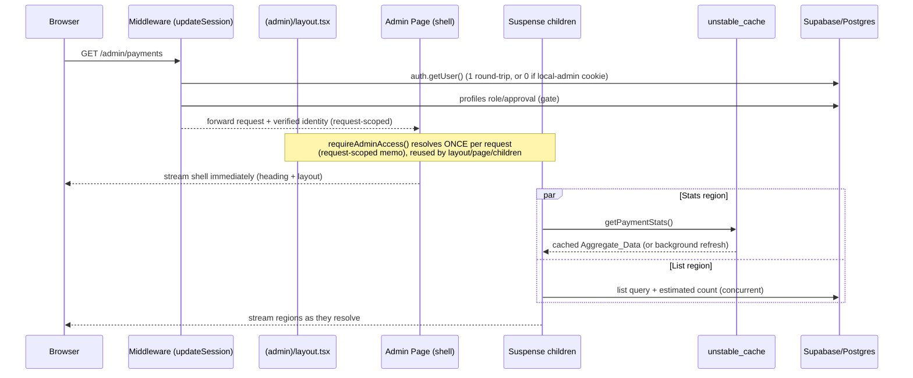

# Design Document

## Overview

This design makes the DAVKAWT admin portal load faster and feel smoother by attacking five
root causes identified in the requirements: redundant authentication round-trips, sequential
blocking data fetches, expensive exact counts, uncached reference/aggregate data, and missing
or unusable indexes. The work is a refactor of existing Next.js App Router server components and
Supabase access patterns — it adds no new product surface area and must preserve the existing
rendered output, authorization model, and data correctness.

The design is organized around six reusable building blocks that are then applied consistently
across the nine admin pages:

1. **Request-level auth memoization** — a per-request cache (keyed to the incoming request, not
   just a single render pass) so the layout, page, and every Suspense child share one identity
   verification and one profile lookup.
2. **Middleware session reuse** — the middleware already performs the gating `getUser()` call;
   the page must not independently re-verify. We pass the middleware-verified user identity down
   so the page-level resolver reuses it instead of issuing a second `auth.getUser()` round-trip.
3. **Streaming with progressive Suspense** — a standard page skeleton (shell renders immediately;
   list region and stats region each stream inside their own Suspense boundary; queries within a
   region run concurrently).
4. **Cache layer** — `unstable_cache` wrappers for Reference_Data and Aggregate_Data with
   bounded `revalidate` windows, stable cache keys/tags, stale-while-revalidate semantics, and
   tag-based invalidation on writes.
5. **Estimated counts** — planned/estimated counts for pagination with an exact-count fallback
   and a visible "approximate" indicator; exact counts retained only for monetary totals.
6. **Indexing** — idempotent migrations providing btree indexes for filter/sort columns and
   pg_trgm GIN indexes for `ilike` searches.

A critical constraint shapes the entire caching design: the local-admin authentication path uses
the **service-role Supabase client, which bypasses RLS** (`lib/supabase/admin.ts`). Any cache that
stores data fetched under that client must be treated as containing potentially RLS-unfiltered
data, and cache keys must guarantee that an identity-scoped value of one administrator is never
served to another. The portal's admin reads are not per-administrator scoped today (all admins see
the same alumni/payments lists), but the design must encode and enforce that invariant rather than
assume it.

### Verified facts the design relies on

- `lib/auth/admin-access.ts` wraps `readAdminAccess` in React `cache()`, but `getAdminAccess()`
  bypasses the cache and `requireAdminAccess()` is the cached path. React `cache()` dedupes only
  within a single render pass, so streamed Suspense children re-resolve. (Req 1)
- `middleware.ts` → `updateSession()` calls `supabase.auth.getUser()` on every protected route,
  then a `profiles` select; local-admin cookie short-circuits the Supabase call for admin routes. (Req 2)
- Dashboard already streams via Suspense + `Promise.all`. Payments and alumni block on sequential
  awaits with no Suspense; payments runs four count/aggregate queries. (Req 3, 5)
- `count: 'exact'` is used for lists and stats throughout. Searches use `ilike '%term%'` on
  `full_name`/`email`/`txnid` via `escapeIlikePattern`/`normalizeSearchTerm`. (Req 5, 6)
- Migration `0004_admin_performance.sql` **already** creates `pg_trgm` and most required indexes
  (btree composites on `approval_status`/`status` + `created_at`, GIN trigram on `full_name`,
  `email`, `txnid`). The indexing work is therefore primarily a **gap-fill + verification**
  exercise, not a from-scratch build. (Req 6)
- Reference data helpers exist: `membership_plans` query inline in pages; `site_settings` via
  `lib/site-settings.ts`. Revalidation helper exists at `lib/utils/revalidate-content.ts` (path-based). (Req 4)

## Architecture

### Request lifecycle (target state)



### Layered structure

| Layer | Module(s) | Responsibility |
|-------|-----------|----------------|
| Routing gate | `middleware.ts`, `lib/supabase/middleware.ts` | One auth round-trip; fail-closed; forward verified identity |
| Auth resolution | `lib/auth/admin-access.ts`, new `lib/auth/request-context.ts` | Request-scoped memoized identity/role/profile |
| Page shell | `app/(admin)/admin/**/page.tsx` | Render shell synchronously; declare Suspense regions |
| Data regions | new `*/sections/*.tsx` async server components | Concurrent queries per region; render content |
| Cache | new `lib/cache/admin-cache.ts` | `unstable_cache` wrappers, keys, tags, revalidate windows |
| Counts | new `lib/db/estimated-count.ts` | planned/estimated count with exact fallback |
| Data access | existing inline queries → optionally `lib/db/*` | Deterministic ordering with unique tie-breaker |
| Invalidation | write actions + `lib/cache/invalidate.ts` | `revalidateTag` on committed writes |
| Schema | `supabase/migrations/000X_*.sql` | Idempotent indexes |

### Key architectural decisions

- **Reuse middleware verification instead of a shared in-memory session cache.** Next.js does not
  give the RSC tree a typed handle to the middleware's Supabase client. We propagate the verified
  user id from middleware to the request via a request header (`x-admin-user-id`, set on the
  forwarded `request` headers in `updateSession`) and read it during page-level resolution. The
  page resolver still constructs an RLS-scoped client from the session cookie for data reads, but
  skips the independent `auth.getUser()` network call when the trusted header is present. This
  satisfies Req 2.3 ("reuse the verified session ... zero additional independent
  session-verification network calls") without weakening security, because the header is set only
  by our own middleware on the server side and is never trusted from the inbound client request
  (middleware strips any inbound copy first).
- **Request-scoped memoization, not just render-pass `cache()`.** React `cache()` is insufficient
  across Suspense boundaries in streaming. We memoize on a request-stable key. The implementation
  uses React `cache()` for the synchronous dedupe plus a module that stores the in-flight promise
  keyed by the request (see Components). Because each request gets a fresh module-isolated memo via
  `cache()`-returned holder, there is no cross-request leakage.
- **`unstable_cache` for data, route remains dynamic for auth.** We do not make whole routes
  static. Only Reference_Data and Aggregate_Data reads are wrapped in `unstable_cache`. The page
  itself stays dynamic so the auth gate runs on every request (Req 8.2).
- **Estimated counts via a Postgres function**, not PostgREST `count: 'estimated'` alone, because
  PostgREST estimated count reflects whole-table planner statistics and does not account for the
  `WHERE` filters of a filtered list. A `SECURITY INVOKER` SQL function returning the planner's
  estimated row count for a parameterized filter gives filter-aware estimates while preserving RLS.

## Components and Interfaces

### 1. Request-scoped auth memoization (`lib/auth/admin-access.ts` + `lib/auth/request-context.ts`)

Goal: at most one identity verification and one profile lookup per Request_Context, shared across
layout, page, and all Suspense children (Req 1.1, 1.2, 1.7), with at most one DB query for the
local-admin profile (Req 1.3).

```ts
// lib/auth/admin-access.ts (revised surface)
export interface AdminAccess {
  actorProfileId: string | null;
  database: AdminDatabaseClient;
  displayName: string;
  email: string;
  mode: 'local' | 'supabase';
  role: 'admin' | 'super_admin';
}

// Memoized per request. Internally:
//  - reads x-admin-user-id header (middleware-verified) to skip auth.getUser()
//  - falls back to auth.getUser() only if the header is absent
//  - runs the local-admin profile resolver in ONE query (see below)
export function requireAdminAccess(options?: AdminAccessOptions): Promise<AdminAccess>;
export function getAdminAccess(options?: AdminAccessOptions): Promise<AdminAccess | null>;
```

Memoization approach:

- Wrap `readAdminAccess` with React `cache()` keyed by the single boolean argument
  `resolveActorProfile`. This already dedupes within a render pass.
- To extend dedupe across Suspense boundaries during streaming, store the in-flight promise in a
  request-stable holder. We use a `cache()`-created holder object (React `cache()` returns the same
  object for the life of one request) that carries the memoized promise:

```ts
// request-stable holder; one instance per request because getHolder is cache()-wrapped
const getHolder = cache(() => ({ promise: null as Promise<AdminAccess | null> | null }));

async function resolveOnce(resolveActorProfile: boolean) {
  const holder = getHolder();
  if (!holder.promise) holder.promise = readAdminAccess(resolveActorProfile);
  return holder.promise;
}
```

This guarantees concurrent Suspense children share one resolution (Req 1.7) and subsequent calls
return the memoized result (Req 1.1, 1.2).

Local-admin profile in one query (Req 1.3): collapse `resolveLocalAdminProfile`'s up-to-three
sequential queries into a single query. Use one statement with `OR` precedence ordering:

```sql
-- conceptual: prefer ADMIN_PROFILE_ID match, then email match, then any approved admin
select id, full_name, email, role
from profiles
where role in ('admin','super_admin') and approval_status = 'approved'
  and (id = :explicit_id or email = :email or :explicit_id is null)
order by (id = :explicit_id) desc, (email = :email) desc, created_at asc
limit 1;
```

Fail-closed behavior (Req 1.4, 1.5, 1.6, 8.5): any null/exception path returns `null` →
`requireAdminAccess` redirects to `/admin-login`. The resolver wraps DB calls in try/catch and
treats errors as "deny".

### 2. Middleware session reuse (`lib/supabase/middleware.ts`)

- Keep the single `auth.getUser()` gate (Req 2.1) and the local-admin zero-call short-circuit
  (Req 2.2).
- After a successful Supabase verification, set a trusted header on the forwarded request so the
  page resolver can skip its own `getUser()`:

```ts
// strip any client-supplied copy first (never trust inbound)
request.headers.delete('x-admin-user-id');
// ...after successful getUser():
response = NextResponse.next({ request });           // request carries the header downstream
request.headers.set('x-admin-user-id', user.id);     // server-set only
```

- Fail-closed on backend/network error (Req 2.5): wrap verification; on throw, redirect to
  `/admin-login` (admin) or `/login` (alumni) rather than calling `NextResponse.next()`.
- Preserve `redirect` query param for unauthenticated protected routes (Req 2.4) — already done.

Note/tradeoff: the page-level RLS client is still built from the session cookie; the header only
authorizes skipping the **network** verification call, it does not itself grant data access. This
keeps RLS intact (Req 8.1).

### 3. Streaming page pattern (applied per page)

Standard structure for a list page (payments/alumni/approvals/announcements/events/forum/reports):

```tsx
export default function Page({ searchParams }: Props) {
  return (
    <div className="...page container...">
      <PageHeader />                                   {/* shell, no await (Req 3.1, 3.5) */}
      <Suspense fallback={<StatsFallback />}>
        <StatsRegion searchParams={searchParams} />    {/* cached Aggregate_Data */}
      </Suspense>
      <FilterForm />                                   {/* shell */}
      <Suspense fallback={<TableFallback />}>
        <ListRegion searchParams={searchParams} />     {/* List_Query + estimated count */}
      </Suspense>
    </div>
  );
}
```

- Independent regions (stats vs list) get separate Suspense boundaries (Req 3.3).
- Within a region, concurrent queries via `Promise.all` (Req 3.4, 5.5).
- Region-scoped error handling: each region component try/catches its own queries and renders a
  scoped error block instead of throwing, so a failed region does not blank the shell or other
  regions (Req 3.7). An optional `error.tsx` per route is a coarser fallback; region-local
  try/catch is the primary mechanism.
- Skeletons reuse `components/shared/Skeleton.tsx` (`StatCardSkeleton`, `TableRowSkeleton`)
  (Req 3.2, 3.6).

### 4. Cache layer (`lib/cache/admin-cache.ts`, `lib/cache/invalidate.ts`)

```ts
export const CACHE_TAGS = {
  referenceMembershipPlans: 'ref:membership-plans',
  referenceSiteSettings: 'ref:site-settings',
  statPendingApprovals: 'stat:pending-approvals',
  statDashboard: 'stat:dashboard',
  statPayments: 'stat:payments',
} as const;

export const REVALIDATE = {
  badge: 60,        // Req 4.5  (<= 60s)
  stats: 120,       // Req 4.7  (<= 120s)
  reference: 300,   // Req 4.6  (<= 300s)
} as const;

// Reference_Data example
export const getMembershipPlans = unstable_cache(
  async () => { /* query under RLS-equivalent read */ },
  ['admin', 'membership-plans'],                 // key parts -> stable, non-identity-scoped
  { tags: [CACHE_TAGS.referenceMembershipPlans], revalidate: REVALIDATE.reference }
);

// Aggregate_Data example (pending-approvals badge)
export const getPendingApprovalsCount = unstable_cache(
  async () => { /* count query */ },
  ['admin', 'pending-approvals-count'],
  { tags: [CACHE_TAGS.statPendingApprovals], revalidate: REVALIDATE.badge }
);
```

Cache classification:

- **Reference_Data**: `membership_plans` (plan list/names/amounts), `site_settings`. Changes only
  via settings writes. `revalidate: 300`.
- **Aggregate_Data**: pending-approvals badge count (`revalidate: 60`); dashboard stat counts and
  payments stat counts other than monetary totals (`revalidate: 120`).

`unstable_cache` provides stale-while-revalidate by default (serves stale within window, refreshes
in background) (Req 4.3) and continues serving the last good value if a refresh fails (Req 4.8).

Invalidation (`lib/cache/invalidate.ts`): on committed writes, call `revalidateTag(tag)` for the
affected tags (Req 4.4, 9.1). Mapping:

| Write action | Tags invalidated |
|---|---|
| approve/reject (`/api/admin/approve`, `/reject`) | `statPendingApprovals`, `statDashboard` |
| alumni edit / membership change | `statDashboard`, `statPayments` |
| payment status change / manual membership | `statPayments`, `statDashboard` |
| settings save (plans/site settings) | `referenceMembershipPlans`, `referenceSiteSettings` |
| event publish/unpublish | `statDashboard` |

Invalidation-failure fallback (Req 9.6): the invalidation helper wraps `revalidateTag` in
try/catch and, on failure, records the failed tag in a request-scoped "dirty set". A thin read
wrapper checks the dirty set and, when a tag is marked dirty, bypasses the cache and reads directly
from the DB until the next successful invalidation. (Because `revalidateTag` is in-process and
rarely throws, this is a defensive path; it is specified so the behavior is deterministic.)

### RLS / identity-isolation safety analysis (Req 8.1, 8.3) — critical

Threat: the local-admin path uses the service-role client (RLS bypassed). If a value fetched under
that client were cached under a key that another administrator's request could hit, and if that
value were identity-scoped, one admin could see another admin's scoped data.

Controls:

1. **Cache only non-identity-scoped data.** Every value placed in `unstable_cache` is portal-global
   (reference data and portal-wide aggregates that every admin is equally authorized to see). No
   cache entry is keyed by or contains a specific administrator's identity. This is an explicit
   invariant enforced by design and tested (see Property 7).
2. **Cache keys never include actor identity** and never include the auth `mode`. This makes it
   impossible to accidentally store a `local` vs `supabase` divergent value; both modes must
   produce the same portal-global value for the same key.
3. **The values cached are equivalent to RLS-scoped reads.** For portal-global admin aggregates
   (e.g., pending-approvals count, total revenue), the RLS policy for an approved admin already
   permits reading all matching rows; the service-role result and the RLS result are identical for
   an authorized admin. We assert this equivalence as a documented precondition: a value is
   cacheable only if, for every authorized admin, the RLS-scoped read returns the same value as the
   service-role read (Req 8.1).
4. **No administrative data is cached at module scope or served without the auth gate.** The page's
   auth gate runs on every request before any cached read is rendered; an unauthenticated request
   redirects before reading cache (Req 8.2).

Conclusion: with these controls, the cache cannot serve identity-scoped data across admins because
no identity-scoped data is ever cached, and keys are identity-independent.

### 5. Estimated counts (`lib/db/estimated-count.ts`)

```ts
// Returns { count, isEstimated }. Falls back to exact when estimation unavailable (Req 5.6).
export async function getListCount(
  client: AdminDatabaseClient,
  opts: { table: string; buildFilter: (q) => q; }
): Promise<{ count: number; isEstimated: boolean }>;
```

Strategy:

1. Primary: call a Postgres RPC `estimate_filtered_count(table, predicate)` that runs
   `EXPLAIN (FORMAT JSON)` for the filtered query and returns `plan.rows` (planner estimate). This
   is filter-aware and cheap (no row scan).
2. If the RPC errors or returns null/0-with-unknown, fall back to `count: 'exact'` so pagination
   still renders (Req 5.6).
3. Monetary totals (total successful revenue) **never** use estimation — always a single exact
   aggregate `amount.sum()` query (Req 5.3, 5.4). Documented reason: financial figures must be
   exact.

Pagination reachability under estimates (Req 5.2): the estimate only affects `totalPages`. To
guarantee every real row is reachable even when the estimate is low, the list region computes
`totalPages` from `max(estimatedCount, offset + rowsReturnedThisPage + (fullPage ? PAGE_SIZE : 0))`.
That is, if the current page returns a full page of rows, we expose at least one more page; the
"last" page is detected when a page returns fewer than `PAGE_SIZE` rows. This makes navigation able
to reach the true last row regardless of estimate error.

Approximate indicator (Req 9.3): when `isEstimated` is true, the count is rendered with a `~`
prefix and an accessible label (e.g., `~1,200 (approximate)`), and is never presented as an exact
total.

### 6. Deterministic ordering (Req 9.4)

All List_Query orderings append a unique tie-breaker. Current pages order by `created_at` only,
which is not unique. Target: `.order('created_at', { ascending }).order('id', { ascending })`
(append `id` as the final unique key). This guarantees a total order, so identical inputs return
identical row order before and after the change (Req 9.4, 9.5).

### 7. Indexing migration (`supabase/migrations/0006_admin_perf_indexes.sql`)

Existing `0004_admin_performance.sql` already provides `pg_trgm` and: `idx_profiles_approval_created`,
`idx_profiles_full_name_trgm`, `idx_profiles_email_trgm`, `idx_payments_status_created`,
`idx_payments_txnid_trgm`. The new migration is a **gap-fill + idempotency hardening** that adds
only what is missing for Req 6.1/6.2 and is safe to re-run (Req 6.6). Candidate gaps:

- `is_paid_member` filter support: `CREATE INDEX IF NOT EXISTS idx_profiles_paid_created ON profiles (is_paid_member, created_at DESC);`
- standalone `created_at` ordering: covered by composite leading columns; add
  `idx_profiles_created_at` only if EXPLAIN shows a seq scan for unfiltered ordered lists.
- verify trigram coverage for all three search columns (`full_name`, `email`, `txnid`) — present.

All statements use `CREATE INDEX IF NOT EXISTS` / `CREATE EXTENSION IF NOT EXISTS` for idempotency
(Req 6.6). Migrations are discrete, version-ordered files in `supabase/migrations` (Req 6.3).
Per-statement transactional application by the migration tool ensures no partial index on failure
(Req 6.5); the migration introduces no data changes so row sets/order are unchanged (Req 6.4).
Tradeoff: `CREATE INDEX CONCURRENTLY` avoids write locks but cannot run inside a transaction; for
this project's migration runner we use plain `CREATE INDEX IF NOT EXISTS` (acceptable at current
scale, and consistent with `0004`).

## Data Models

No table schema changes (no new columns/tables). The design adds: indexes (DDL only), one read-only
SQL function for estimated counts, and application-level cache/identity types.

### Auth/session types

```ts
// Trusted, server-set request header carrying the middleware-verified user id.
// Never read from the inbound client request (middleware deletes any inbound copy).
type VerifiedIdentityHeader = 'x-admin-user-id';

interface RequestAuthMemo {
  promise: Promise<AdminAccess | null> | null;  // request-scoped, one per request
}
```

### Cache descriptor

```ts
type CacheClass = 'reference' | 'aggregate-stat' | 'aggregate-badge';

interface CachedValueDescriptor {
  keyParts: string[];          // identity-independent (no actor id, no auth mode)
  tags: string[];              // for revalidateTag invalidation
  revalidateSeconds: number;   // badge<=60, stat<=120, reference<=300
  class: CacheClass;
}
```

### Count result

```ts
interface CountResult {
  count: number;
  isEstimated: boolean;        // true -> render with "~ approximate" indicator (Req 9.3)
}
```

### Estimated-count SQL function (read-only, RLS-respecting)

```sql
-- SECURITY INVOKER: runs under the caller's role so RLS still applies to any actual reads.
-- Returns the planner's estimated row count for a parameterized filter; no row scan.
CREATE OR REPLACE FUNCTION estimate_filtered_count(...)
RETURNS bigint
LANGUAGE plpgsql STABLE SECURITY INVOKER AS $$ ... EXPLAIN (FORMAT JSON) ... $$;
```

### Deterministic ordering contract

Every List_Query MUST order by its display sort column(s) followed by a unique tie-breaker `id`,
producing a total order over rows. This is a data-access invariant, not a schema change.

## Correctness Properties

*A property is a characteristic or behavior that should hold true across all valid executions of a
system — essentially, a formal statement about what the system should do. Properties serve as the
bridge between human-readable specifications and machine-verifiable correctness guarantees.*

PBT applies to this feature because several core pieces are pure functions or deterministic logic
with large input spaces: the authorization decision, the auth round-trip single-flight memo,
pagination math under estimated counts, deterministic ordering, result-set equivalence, cache-key
construction, and the count fallback/indicator logic. Infrastructure concerns (query-planner index
usage, Next.js stale-while-revalidate internals, RLS policy enforcement, and performance
benchmarks) are validated by integration tests, not PBT — see Testing Strategy.

The properties below were consolidated during prework reflection to remove redundancy (for example,
the five criteria about "resolve auth once per request" collapse into a single round-trip-count
invariant, and the three authorization criteria collapse into one total-decision property).

### Property 1: Auth resolution single-flight per request

*For any* number and arrival arrangement (sequential or concurrent) of `requireAdminAccess` callers
within a single Request_Context, the underlying authentication resolution performs at most one
identity-verification step and at most one profile lookup, and every caller receives the same
memoized result.

**Validates: Requirements 1.1, 1.2, 1.7, 2.3, 7.4**

### Property 2: Authorization is a total decision

*For any* resolved session input (a profile, a missing profile, or an indeterminate/error result),
the Auth_Resolver returns a definite decision that grants access if and only if the profile's
`approval_status` is `approved` and its `role` is `admin` or `super_admin`, and denies (redirect to
`/admin-login`) in every other case, including indeterminate inputs.

**Validates: Requirements 1.6, 8.4, 8.5**

### Property 3: Auth errors fail closed

*For any* error injected at any step of authentication resolution (in the page resolver or in
middleware), the system denies access and redirects to the login route, and never returns an
authenticated result or renders administrative data.

**Validates: Requirements 1.5, 2.5**

### Property 4: Local-admin profile resolves in one query

*For any* combination of inputs (explicit `ADMIN_PROFILE_ID` present or absent, email match present
or absent, an approved admin existing or not), the local-admin profile resolver issues at most one
profile query per Request_Context and returns the correct precedence winner (explicit id, then
email match, then earliest approved admin).

**Validates: Requirements 1.3**

### Property 5: Middleware auth round-trip count

*For any* request characterized by (route class ∈ {admin, alumni, auth-page, public}, local-admin
cookie present or absent), Middleware_Auth performs at most one authentication network round-trip,
and performs zero `auth.getUser()` calls when a valid local-admin cookie is present on an admin
route.

**Validates: Requirements 2.1, 2.2**

### Property 6: Unauthenticated redirect preserves destination

*For any* protected pathname and query string with no valid session, Middleware_Auth produces a
redirect whose target is `/admin-login` for admin routes and `/login` for alumni routes, and whose
`redirect` query parameter equals the originally requested path.

**Validates: Requirements 2.4**

### Property 7: Cache issues at most one load per revalidation window

*For any* cached descriptor (Reference_Data or Aggregate_Data) and any sequence of reads occurring
within a single Revalidation_Window, the underlying database loader is invoked at most once; reads
after the first within the window are served from cache.

**Validates: Requirements 4.1, 4.2**

### Property 8: Writes invalidate exactly the mapped cache tags

*For any* administrator write action, the invalidation helper requests invalidation of exactly the
set of cache tags mapped to that action type (no missing tags, no unrelated tags), so the first
read after the write reflects the change.

**Validates: Requirements 4.4, 9.1**

### Property 9: Invalidation failure forces cache bypass

*For any* committed write whose tag invalidation fails, subsequent reads of the affected value
bypass the cache and read directly from the database until a later invalidation succeeds, so a stale
value is never served after a failed invalidation.

**Validates: Requirements 9.6**

### Property 10: Estimated-count failure falls back to exact

*For any* failure of the estimated-count path (RPC error, null/unusable estimate), `getListCount`
returns a usable exact count result (`isEstimated = false`) without throwing, so pagination still
renders.

**Validates: Requirements 5.6**

### Property 11: Pagination reachability under estimated counts

*For any* true matching-row count, any (possibly inaccurate) estimated count, any positive page
size, and any current page, the pagination model allows navigation to reach the page containing the
last real row: when a page returns a full page of rows at least one further page is reachable, and a
page returning fewer than the page size is recognized as terminal.

**Validates: Requirements 5.2**

### Property 12: Approximate counts are labeled, exact counts are not

*For any* `CountResult`, the rendered count label includes the approximate indicator if and only if
`isEstimated` is true, and an estimated value is never presented as an exact total.

**Validates: Requirements 9.3**

### Property 13: Refactored pages issue at most two sequential round-trips

*For any* refactored Admin_Page data plan that previously issued four or more sequential
count/aggregate queries, the number of sequential (non-concurrent) database round-trips is two or
fewer, with per-region queries batched concurrently and auth reused.

**Validates: Requirements 3.4, 5.5, 7.5**

### Property 14: Deterministic total ordering with unique tie-breaker

*For any* set of rows — including rows sharing the same primary sort key (for example equal
`created_at`) — ordering by the display sort key followed by the unique `id` tie-breaker produces a
single deterministic total order that is independent of the rows' initial arrival order.

**Validates: Requirements 6.4, 9.4**

### Property 15: Result-set, pagination, and export equivalence

*For any* filter, search, and page-size inputs, the union of all paginated pages (under the
deterministic ordering) equals exactly the full filtered, ordered result set with no gaps or
overlaps, and the exported file contents equal that same ordered result set.

**Validates: Requirements 9.5**

### Property 16: Cache keys are identity-independent (no cross-admin leakage)

*For any* two distinct administrator identities (and either auth `mode`, `local` or `supabase`) and
any cached descriptor, the generated cache key is identical and contains no administrator identity
or auth-mode component; therefore no identity-scoped value of one administrator can be served to
another.

**Validates: Requirements 8.3**

## Error Handling

| Failure | Detection | Handling | Requirement |
|---|---|---|---|
| Unauthenticated / non-admin at page | resolver returns null | redirect `/admin-login`; render nothing | 1.4, 1.6, 8.2 |
| Backend error during page auth | try/catch in resolver | treat as deny → redirect (fail closed) | 1.5 |
| Backend/network error in middleware | try/catch around `getUser` | redirect to login; never pass through | 2.5 |
| Region query fails (list/stats) | region-local try/catch | render scoped error block; keep shell + other regions | 3.7 |
| Estimated count unavailable | RPC error/null | fall back to exact count | 5.6 |
| Cache background refresh fails | handled by `unstable_cache` | serve last good value within window; no surfaced error | 4.8 |
| Cache invalidation throws after write | try/catch in invalidate helper | mark tag dirty → reads bypass cache to DB until success | 9.6 |
| Indexing migration statement fails | migration runner transaction | no partial apply; surface error | 6.5 |

Principles: authentication/authorization failures always **fail closed** (deny). Data-region
failures **fail soft** (scoped error, page shell preserved). Cache failures **degrade to direct DB
reads** rather than serving stale or erroring.

## Testing Strategy

### Dual approach

- **Property-based tests** verify the universal properties above (Properties 1–16) across many
  generated inputs.
- **Unit/example tests** cover specific scenarios, edge cases, and rendering behavior.
- **Integration tests** cover infrastructure that PBT cannot meaningfully exercise.

### Property-based testing

- Library: **fast-check** with the existing test runner (Vitest/Jest as configured in the repo).
  Do not hand-roll generators or shrinking.
- Each property test runs **minimum 100 iterations**.
- Each test is tagged with a comment referencing its design property in the format:
  `// Feature: admin-portal-performance, Property {n}: {property text}`.
- One property-based test per correctness property (Properties 1–16). Pure-logic properties
  (2, 11, 12, 14, 15, 16) test functions directly. Behavioral properties (1, 3, 4, 5, 7, 8, 9, 10,
  13) use instrumented fakes (a counting auth backend, a fake cache recording loads/invalidations,
  a stubbed estimate RPC) so call-counts and fallbacks are observable without real I/O.

Suggested testable seams to extract so properties are unit-addressable:
- `authorizeProfile(profile | null): { grant: boolean }` — Property 2.
- `resolveLocalAdminProfile` reduced to one query builder — Property 4.
- `computePagination({ rowsReturned, pageSize, page, estimate }): { totalPages, hasNext }` — Property 11.
- `orderWithTieBreaker(rows, sortKey, dir)` — Property 14.
- `formatCount(result: CountResult): string` — Property 12.
- `buildCacheKey(descriptor)` — Property 16.
- `invalidateForAction(action): string[]` — Property 8.

### Integration tests (not PBT)

- **Index usage (6.1, 6.2):** seed ≥10,000 rows; run `EXPLAIN`/`EXPLAIN ANALYZE` for filtered,
  ordered, and `ilike` queries; assert index/bitmap scan rather than seq scan. 1–3 examples per
  column/search field.
- **Migration idempotency & atomicity (6.5, 6.6):** apply the migration twice (assert success, no
  duplicate index); simulate a failing statement (assert rollback + surfaced error).
- **Stale-while-revalidate (4.3, 4.8):** against the Next.js cache, assert stale value served on the
  triggering request after expiry, refreshed value on the subsequent read, and last-good value
  retained when the loader throws.
- **RLS preserved (8.1):** confirm RLS policies still apply to reads after the refactor; pair with
  Property 16 for the identity-isolation guarantee.

### Render / snapshot tests (not PBT)

- Streaming behavior (3.1, 3.2, 3.3, 3.5, 3.6, 3.7): shell renders before regions resolve;
  skeletons shown while pending; resolved content replaces skeleton; a failing region shows a scoped
  error while the shell/other regions persist.
- Layout equivalence (10.3): snapshot of the fully-resolved page equals the pre-optimization
  baseline, with only transient Skeleton/Suspense additions permitted.

### Configuration assertions (smoke)

- `REVALIDATE.badge ≤ 60` (4.5), `REVALIDATE.reference ≤ 300` (4.6), `REVALIDATE.stats ≤ 120` (4.7).

### Performance measurement procedure (Req 7)

Documented and reproducible so an independent tester reaches the same pass/fail conclusion:

1. **Data volume:** seed ≥10,000 rows in each primary table backing the page under test
   (`profiles`, `payments`, etc.).
2. **Environment:** fixed configuration (same machine/instance class, same Supabase instance/region,
   production build `next build && next start`, warm cache excluded/recorded separately).
3. **Sample:** ≥100 page requests / ≥100 navigations per measured page.
4. **Capture:** TTFB (e.g., via `curl -w` or a load tool) and per-page DB round-trip count (via
   query logging / Supabase logs); compute the 75th percentile.
5. **Targets:** TTFB p75 ≤ 500 ms (7.1); navigation meaningful-content p75 ≤ 1000 ms (7.2);
   ≤1 auth-related DB round-trip per request (7.4); ≤2 sequential round-trips on previously-4+ pages
   (7.5). A navigation p75 > 1000 ms is recorded as a violation (7.3).
6. **Baseline vs result:** record a pre-change baseline and a post-change result with identical
   volume, sample, and environment (7.7).

### CI gate (Req 10.4, 10.5)

Completion requires: production build succeeds, zero new lint errors vs baseline, zero new
type-check errors vs baseline, and no previously passing test regresses. Any failure means the
optimization is not complete until resolved.

### Portal-wide inventory (Req 10.2) — to be produced during implementation

A written inventory naming each public/alumni-facing page exhibiting a blocking-await pattern
(Req 3), an exact-count pattern (Req 5), or an uncached-reference-data pattern (Req 4), labeling the
specific pattern(s) per page. Candidate areas to audit include `app/(alumni)/*`,
`app/(public)/*`, and any directory/list pages reusing `count: 'exact'`, sequential awaits, or
inline `membership_plans`/`site_settings` reads.

## Design Decisions and Tradeoffs

1. **Header-based session reuse vs. shared client object.** We pass the middleware-verified user id
   via a server-set, inbound-stripped request header rather than trying to share a Supabase client
   instance across middleware and RSC (not supported by Next.js). Tradeoff: the page still builds an
   RLS client from the session cookie for reads; the header only authorizes skipping the redundant
   `getUser()` network call. This satisfies Req 2.3 while keeping RLS intact (Req 8).
2. **Filter-aware estimated counts via a Postgres function** instead of PostgREST `count:
   'estimated'`. PostgREST's estimate reflects whole-table statistics and ignores `WHERE` filters,
   which would make filtered pagination wildly inaccurate. The `EXPLAIN`-based function is
   filter-aware. Tradeoff: a small added RPC surface; mitigated by the exact-count fallback (Req 5.6).
3. **Cache only portal-global data.** Given the local-admin path bypasses RLS via the service-role
   client, the safest invariant is to never cache identity-scoped data and to keep cache keys
   identity-independent (Property 16). Tradeoff: per-admin personalized aggregates (if ever added)
   cannot use this cache and would need per-identity keys; none exist today.
4. **Reuse existing indexes; gap-fill only.** Migration `0004_admin_performance.sql` already covers
   most required indexes, so the new migration is minimal and idempotent. Tradeoff: we rely on
   `EXPLAIN` verification to confirm coverage rather than recreating indexes.
5. **Plain `CREATE INDEX IF NOT EXISTS`** (not `CONCURRENTLY`) to remain transactional and
   consistent with the existing migration style. Tradeoff: brief write lock during index build,
   acceptable at current data scale.
6. **Region-local try/catch as the primary region error boundary**, with optional `error.tsx` as a
   coarser net. This gives scoped, non-blank failures (Req 3.7) without losing the shell.
