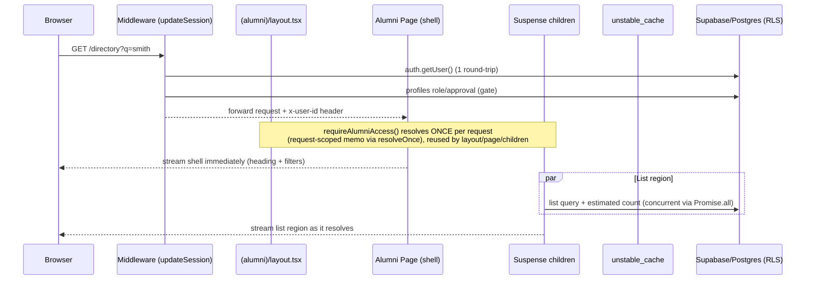

# Design Document

## Overview

This design makes the DAVKAWT alumni (member) portal load faster and feel smoother by
applying the same six building blocks already implemented for the admin portal — request-level
auth memoization, streaming Suspense, cached reference data, estimated counts, deterministic
ordering, and trigram indexing — to the seven alumni pages: directory, announcements, events,
forum, dashboard, membership, and profile.

The work is a refactor of existing Next.js App Router server components and Supabase access
patterns under `app/(alumni)/`. It adds no new product surface area and must preserve the
existing rendered output, authorization model (alumni RLS), and data correctness.

**Critical reuse constraint:** all infrastructure already exists from the admin-portal-performance
spec. This design extends and imports those modules; it does **not** create parallel
implementations.

| Building block | Existing module | Alumni extension |
|---|---|---|
| Request-scoped auth memoization | `lib/auth/request-context.ts` | New `requireAlumniAccess()` using the same `resolveOnce` pattern |
| Trusted identity header | `lib/supabase/middleware.ts` | Already covers alumni routes (`x-user-id` header set for all authenticated requests) |
| Streaming with Suspense | Pattern in admin pages | Apply to all 7 alumni pages |
| Cache layer | `lib/cache/admin-cache.ts` | Add `getMembershipPlansForAlumni` entry (or share `getMembershipPlans`) |
| Estimated counts | `lib/db/estimated-count.ts` | Import `getListCount` directly |
| Deterministic ordering | `lib/db/ordering.ts` | Import `orderWithTieBreaker` pattern; apply `.order('id')` to all list queries |
| Skeleton components | `components/shared/Skeleton.tsx` | Reuse/compose existing components |
| Trigram indexes | `supabase/migrations/0004_admin_performance.sql` | New migration for `company`, `occupation`, `industry`, `current_city`, `current_state`, `current_country` |
| Pagination math | `lib/db/pagination.ts` | Import `computePagination` directly |

### Key facts from the codebase

- The middleware already strips `x-admin-user-id` (aliased as `x-user-id`) from inbound requests
  and sets it after successful `getUser()` for **all** protected routes (admin and alumni). The
  header is already available to alumni pages.
- Alumni pages currently call `supabase.auth.getUser()` independently (dashboard, membership,
  profile) — redundant with middleware verification.
- The directory page uses `count: 'exact'` and `ilike` searches on `company`, `occupation`,
  `industry`, `current_city`, `current_state`, `current_country` — columns that lack trigram
  indexes (only `full_name` and `email` have them from migration `0004`).
- All list pages lack a unique tie-breaker: directory orders by `full_name` or `batch_year`
  without `id`; announcements by `is_pinned`/`published_at`; events by `starts_at`.
- Membership plans are queried fresh on every membership page load despite changing rarely.
- The forum page fetches categories then threads sequentially (two awaits).
- Profile and payment data are identity-scoped and must never be cached.

## Architecture

### Request lifecycle (target state)



### Alumni page data plan summary

| Page | Shell | Region 1 | Region 2 | Caching | Identity-scoped? |
|------|-------|----------|----------|---------|-----------------|
| Directory | heading + filter form | list (estimated count + paginated query, concurrent) | — | none | no |
| Announcements | heading | list (estimated count + paginated query, concurrent) | — | none | no |
| Events | heading + filter tabs | list (estimated count + paginated query, concurrent) | — | none | no |
| Forum | heading | categories (ordered by display_order + id) | threads stats (concurrent with categories) | none | no |
| Dashboard | heading + stats cards | stats region (batch peers count) | peers region (upcoming events + recent announcements, concurrent) | none | partially (batch_year from profile) |
| Membership | heading + status banner | plans region (cached, ~300s) | payments region (fresh, identity-scoped) | plans only | payments: yes |
| Profile | heading + avatar | profile form region (fresh, identity-scoped) | — | none | yes |

### Layered structure

| Layer | Module(s) | Responsibility |
|-------|-----------|----------------|
| Routing gate | `middleware.ts`, `lib/supabase/middleware.ts` | One auth round-trip; fail-closed; forward verified identity via `x-user-id` |
| Auth resolution | new `lib/auth/alumni-access.ts`, existing `lib/auth/request-context.ts` | Request-scoped memoized alumni identity/profile |
| Page shell | `app/(alumni)/**/page.tsx` | Render shell synchronously; declare Suspense regions |
| Data regions | new `*/sections/*.tsx` async server components | Concurrent queries per region; render content |
| Cache | `lib/cache/admin-cache.ts` (extended) | `unstable_cache` wrapper for membership plans (shared entry) |
| Counts | `lib/db/estimated-count.ts` (imported) | Estimated count with exact fallback |
| Pagination | `lib/db/pagination.ts` (imported) | Reachable pagination under inaccurate estimates |
| Ordering | `lib/db/ordering.ts` pattern | `.order(sortKey).order('id')` on all list queries |
| Schema | `supabase/migrations/000X_alumni_perf_indexes.sql` | Idempotent trigram indexes for search columns |

## Components and Interfaces

### 1. Alumni auth resolver (`lib/auth/alumni-access.ts`)

Goal: at most one identity verification and one profile lookup per Request_Context, shared
across layout, page, and all Suspense children (Req 1.1–1.4). Reuses `resolveOnce` from
`lib/auth/request-context.ts`.

```ts
// lib/auth/alumni-access.ts
import { redirect } from 'next/navigation';
import { headers } from 'next/headers';
import { resolveOnce, type RequestScopedLoader } from '@/lib/auth/request-context';
import { createClient } from '@/lib/supabase/server';

export interface AlumniAccess {
  userId: string;
  profile: {
    id: string;
    full_name: string;
    email: string;
    batch_year: number;
    course: string;
    is_paid_member: boolean;
    membership_expires_at: string | null;
    avatar_url: string | null;
    approval_status: string;
  };
  database: Awaited<ReturnType<typeof createClient>>;
}

/**
 * The underlying loader — NOT called directly by pages.
 * Reads the trusted x-user-id header (set by middleware) to skip auth.getUser().
 * Constructs an RLS-scoped client from the session cookie for data reads.
 * Fail-closed: returns null on any error.
 */
const readAlumniAccess: RequestScopedLoader<AlumniAccess | null> = async () => {
  try {
    const headerStore = await headers();
    const userId = headerStore.get('x-user-id');
    if (!userId) return null;

    const supabase = await createClient();
    const { data: profile } = await supabase
      .from('profiles')
      .select('id, full_name, email, batch_year, course, is_paid_member, membership_expires_at, avatar_url, approval_status')
      .eq('id', userId)
      .single();

    if (!profile || profile.approval_status !== 'approved') return null;

    return { userId, profile, database: supabase };
  } catch {
    return null; // fail closed
  }
};

/**
 * Request-scoped memoized alumni access. The first caller resolves; concurrent
 * and subsequent callers within the same request receive the same promise.
 * Reuses resolveOnce from lib/auth/request-context.ts (Req 10.1).
 */
export function getAlumniAccess(): Promise<AlumniAccess | null> {
  // false = no separate "resolveActorProfile" variant needed for alumni
  return resolveOnce(false, readAlumniAccess);
}

/**
 * Require alumni access or redirect to /login. Every alumni page calls this.
 */
export async function requireAlumniAccess(): Promise<AlumniAccess> {
  const access = await getAlumniAccess();
  if (!access) {
    redirect('/login');
  }
  return access;
}
```

### 2. Middleware extension (already complete)

The middleware (`lib/supabase/middleware.ts`) already:
- Strips `x-admin-user-id` from inbound requests (renamed to be route-agnostic)
- Calls `supabase.auth.getUser()` once for alumni routes
- Checks profile existence and `approval_status === 'approved'`
- Sets the trusted header after successful verification
- Redirects to `/login` on failure (fail-closed)
- Preserves the `redirect` query parameter

No new middleware code is needed. The header is already available to alumni pages.

### 3. Streaming page pattern (applied per page)

Standard structure applied to each alumni page:

```tsx
// Example: directory/page.tsx (target)
export default function DirectoryPage({ searchParams }: Props) {
  return (
    <div className="mx-auto max-w-6xl px-4 py-10 sm:px-6 lg:px-8">
      <PageHeader />                                     {/* shell, no await */}
      <FilterForm searchParams={searchParams} />         {/* shell */}
      <Suspense fallback={<DirectoryListSkeleton />}>
        <DirectoryListRegion searchParams={searchParams} />
      </Suspense>
    </div>
  );
}
```

For pages with multiple independent regions (dashboard, forum, membership):

```tsx
// Example: membership/page.tsx (target)
export default function MembershipPage({ searchParams }: Props) {
  return (
    <div className="mx-auto max-w-4xl px-4 py-10 sm:px-6 lg:px-8">
      <PageHeader />
      <Suspense fallback={<PlansSkeleton />}>
        <PlansRegion />                                  {/* cached reference data */}
      </Suspense>
      <Suspense fallback={<PaymentsSkeleton />}>
        <PaymentsRegion />                               {/* identity-scoped, fresh */}
      </Suspense>
    </div>
  );
}
```

Region-scoped error handling: each async region component wraps its queries in try/catch
and renders a scoped error block on failure (preserving shell + other regions).

Skeletons: reuse `CardSkeleton`, `TableRowSkeleton`, `StatCardSkeleton` from
`components/shared/Skeleton.tsx`, composing page-specific fallbacks (e.g.,
`DirectoryListSkeleton` renders a grid of `CardSkeleton` elements).

### 4. Cache layer extension (`lib/cache/admin-cache.ts`)

Add an alumni-accessible membership plans entry. Since the existing `getMembershipPlans`
already returns portal-global plan data and alumni need the same shape (active plans with
id, name, description, amount, membership_type, duration_months), we can either:

**Option A (preferred):** Add a new cached function for alumni that selects only active plans:

```ts
// Added to lib/cache/admin-cache.ts

export const ALUMNI_CACHE_DESCRIPTORS = {
  membershipPlansAlumni: {
    keyParts: ['alumni', 'reference', 'membership-plans-active'],
    tags: [CACHE_TAGS.referenceMembershipPlans],
    revalidateSeconds: REVALIDATE.reference, // <= 300s
    class: 'reference' as CacheClass,
  },
} as const;

export interface MembershipPlanAlumni {
  id: string;
  name: string;
  description: string | null;
  amount: number;
  membership_type: string;
  duration_months: number | null;
}

export const getMembershipPlansForAlumni = unstable_cache(
  async (): Promise<MembershipPlanAlumni[]> => {
    const supabase = createAdminClient();
    const { data } = await supabase
      .from('membership_plans')
      .select('id, name, description, amount, membership_type, duration_months')
      .eq('is_active', true)
      .order('amount', { ascending: true });
    return (data ?? []) as MembershipPlanAlumni[];
  },
  buildCacheKey(ALUMNI_CACHE_DESCRIPTORS.membershipPlansAlumni),
  {
    tags: ALUMNI_CACHE_DESCRIPTORS.membershipPlansAlumni.tags,
    revalidate: ALUMNI_CACHE_DESCRIPTORS.membershipPlansAlumni.revalidateSeconds,
  }
);
```

The existing `referenceMembershipPlans` tag invalidation (triggered when admin modifies plans)
also invalidates this entry because the tag is shared (Req 3.4).

### 5. Estimated counts (reuse `lib/db/estimated-count.ts`)

Alumni list pages (directory, announcements, events) import `getListCount` directly:

```ts
import { getListCount } from '@/lib/db/estimated-count';

// In the list region component:
const [{ data: rows }, countResult] = await Promise.all([
  listQuery.range(offset, offset + PAGE_SIZE - 1),
  getListCount(supabase, {
    table: 'profiles',
    filters: buildDirectoryFilters(searchParams),
    exactFallback: () => supabase.from('profiles')
      .select('id', { count: 'exact', head: true })
      .eq('approval_status', 'approved')
      .eq('is_active', true),
  }),
]);
```

Pagination computed via `computePagination` from `lib/db/pagination.ts`:

```ts
import { computePagination } from '@/lib/db/pagination';

const { totalPages, hasNext } = computePagination({
  rowsReturned: rows?.length ?? 0,
  pageSize: PAGE_SIZE,
  page,
  estimate: countResult.count,
});
```

The count displayed uses `formatCount` from `lib/db/count-format.ts` with the `~` prefix
for estimated values.

### 6. Deterministic ordering

All list queries append `id` as the final unique tie-breaker:

```ts
// Directory example (name sort):
query = query
  .order('full_name', { ascending: true })
  .order('id', { ascending: true });  // tie-breaker

// Announcements:
query = query
  .order('is_pinned', { ascending: false })
  .order('published_at', { ascending: false })
  .order('id', { ascending: false });  // tie-breaker

// Events (upcoming):
query = query
  .order('starts_at', { ascending: true })
  .order('id', { ascending: true });  // tie-breaker

// Forum categories:
query = query
  .order('display_order', { ascending: true })
  .order('id', { ascending: true });  // tie-breaker
```

### 7. Trigram index migration (`supabase/migrations/000X_alumni_directory_indexes.sql`)

The existing migration `0004_admin_performance.sql` already creates trigram indexes for
`full_name` and `email`. The new migration adds indexes for the remaining directory search
columns:

```sql
-- Alumni directory search performance: trigram indexes for ilike substring matching.
-- Only creates indexes that don't already exist (full_name and email covered by 0004).
-- Req 6.6: uses CREATE INDEX IF NOT EXISTS for idempotency.

CREATE EXTENSION IF NOT EXISTS pg_trgm;

CREATE INDEX IF NOT EXISTS idx_profiles_company_trgm
  ON profiles USING gin (company gin_trgm_ops);

CREATE INDEX IF NOT EXISTS idx_profiles_occupation_trgm
  ON profiles USING gin (occupation gin_trgm_ops);

CREATE INDEX IF NOT EXISTS idx_profiles_industry_trgm
  ON profiles USING gin (industry gin_trgm_ops);

CREATE INDEX IF NOT EXISTS idx_profiles_current_city_trgm
  ON profiles USING gin (current_city gin_trgm_ops);

CREATE INDEX IF NOT EXISTS idx_profiles_current_state_trgm
  ON profiles USING gin (current_state gin_trgm_ops);

CREATE INDEX IF NOT EXISTS idx_profiles_current_country_trgm
  ON profiles USING gin (current_country gin_trgm_ops);
```

All statements use `CREATE INDEX IF NOT EXISTS` so re-application is idempotent (Req 6.5).
The migration creates no data changes, so result sets and ordering remain unchanged (Req 6.3).

### RLS / identity-isolation safety analysis

The alumni auth path uses the **RLS-scoped client** (built from the user's session cookie),
unlike the admin path which uses the service-role client. This means:

1. **All alumni data reads are RLS-enforced by default.** The Supabase client constructed in
   `requireAlumniAccess()` inherits the user's session and all queries execute under their
   RLS policies.
2. **Cached membership plans use the service-role client** (inside `unstable_cache` callbacks,
   which run outside request scope). This is safe because membership plans are portal-global
   reference data — every authenticated alumni user is equally entitled to see the same plan
   catalog. The cache key is identity-independent.
3. **Identity-scoped data (profile, payments) is NEVER cached.** It is always queried fresh
   under the user's own RLS-scoped client (Req 3.6, 7.3). One user's data cannot leak to another.
4. **The auth gate runs on every request** before any cached or fresh data is read (Req 7.4).
   An unauthenticated request redirects before reaching any data layer.

## Data Models

No table schema changes. The design adds: trigram indexes (DDL only) and application-level
auth/cache types.

### Alumni auth types

```ts
export interface AlumniAccess {
  userId: string;
  profile: AlumniProfile;
  database: SupabaseClient; // RLS-scoped
}

interface AlumniProfile {
  id: string;
  full_name: string;
  email: string;
  batch_year: number;
  course: string;
  is_paid_member: boolean;
  membership_expires_at: string | null;
  avatar_url: string | null;
  approval_status: string;
}
```

### Cache descriptor (alumni addition)

```ts
// Added to ALUMNI_CACHE_DESCRIPTORS in lib/cache/admin-cache.ts
membershipPlansAlumni: {
  keyParts: ['alumni', 'reference', 'membership-plans-active'],
  tags: [CACHE_TAGS.referenceMembershipPlans],  // shared tag with admin
  revalidateSeconds: 300,
  class: 'reference',
}
```

### Count result (reused from admin)

```ts
// lib/db/count-format.ts (already exists)
export interface CountResult {
  count: number;
  isEstimated: boolean;
}
```

### Pagination result (reused from admin)

```ts
// lib/db/pagination.ts (already exists)
export interface PaginationResult {
  totalPages: number;
  hasNext: boolean;
}
```

### Page applicability matrix

| Pattern | Directory | Announcements | Events | Forum | Dashboard | Membership | Profile |
|---------|-----------|---------------|--------|-------|-----------|------------|---------|
| Auth memoization (Req 1) | ✓ | ✓ | ✓ | ✓ | ✓ | ✓ | ✓ |
| Streaming/Suspense (Req 2) | ✓ | ✓ | ✓ | ✓ | ✓ | ✓ | ✓ |
| Cache plans (Req 3) | — | — | — | — | — | ✓ (plans) | — |
| Estimated counts (Req 4) | ✓ | ✓ | ✓ | — (no pagination) | — | — | — |
| Deterministic ordering (Req 5) | ✓ | ✓ | ✓ | ✓ (categories) | — | — | — |
| Trigram indexes (Req 6) | ✓ | — | — | — | — | — | — |

Non-applicable patterns documented per Req 9.2:
- **Forum**: No estimated counts because it does not paginate (shows all active categories).
- **Dashboard**: No estimated counts (shows fixed stats). No deterministic ordering (limit-based, not paginated).
- **Membership**: No estimated counts (plans are a short list; payments limited to 10).
- **Profile**: Single-record view, no list/count/ordering patterns apply.

## Correctness Properties

*A property is a characteristic or behavior that should hold true across all valid executions of a
system — essentially, a formal statement about what the system should do. Properties serve as the
bridge between human-readable specifications and machine-verifiable correctness guarantees.*

PBT applies to this feature because several core pieces are pure functions or deterministic logic
with large input spaces: the authorization decision, the auth single-flight memo, pagination math
under estimated counts, deterministic ordering, result-set equivalence, cache-key construction,
and the count fallback/indicator logic. Infrastructure concerns (query-planner index usage,
Next.js stale-while-revalidate internals, RLS policy enforcement, streaming render behavior)
are validated by integration tests, not PBT.

### Property 1: Auth resolution single-flight per request

*For any* number and arrival arrangement (sequential or concurrent) of `requireAlumniAccess`
callers within a single Request_Context, the underlying authentication resolution performs at
most one identity-verification step and at most one profile lookup, and every caller receives
the same memoized result.

**Validates: Requirements 1.1, 1.2, 1.4**

### Property 2: Unauthenticated redirect preserves destination

*For any* alumni route pathname and query string with no valid session (missing or unverifiable
identity), Middleware_Auth produces a redirect whose target is `/login` and whose `redirect`
query parameter equals the originally requested path.

**Validates: Requirements 1.5**

### Property 3: Auth errors fail closed

*For any* error injected at any step of authentication resolution (in the page resolver or in
middleware), the system denies access and redirects to `/login`, and never returns an
authenticated result or renders alumni data.

**Validates: Requirements 1.6**

### Property 4: Authorization is a total decision

*For any* resolved session input (a profile with any `approval_status`, a missing profile, or
an indeterminate/error result), the Alumni_Auth_Resolver returns a definite decision that
grants access if and only if the profile's `approval_status` is `approved`, and denies
(redirect to `/login`) in every other case including indeterminate inputs.

**Validates: Requirements 1.7, 7.2**

### Property 5: Concurrent queries within a region

*For any* alumni page data plan that requires multiple independent queries to render one region,
those queries are issued concurrently (via `Promise.all`) rather than sequentially, resulting in
at most two sequential round-trips per page (auth + one concurrent batch per region).

**Validates: Requirements 2.4, 4.5**

### Property 6: Cache issues at most one load per revalidation window

*For any* cached descriptor (membership plans) and any sequence of reads occurring within a
single Revalidation_Window, the underlying database loader is invoked at most once; reads after
the first within the window are served from cache.

**Validates: Requirements 3.1, 3.2**

### Property 7: Writes invalidate exactly the mapped cache tags

*For any* administrator write action that modifies membership plans, the invalidation helper
requests invalidation of exactly the `referenceMembershipPlans` tag, so the first alumni read
after the write returns the updated plan catalog.

**Validates: Requirements 3.4**

### Property 8: Cache keys are identity-independent (no cross-user leakage)

*For any* two distinct alumni user identities and any cached descriptor, the generated cache key
is identical and contains no user identity component; therefore no identity-scoped value can be
served from the cache to any user. Additionally, the set of cached descriptors contains no
entry classified as identity-scoped data.

**Validates: Requirements 3.6, 7.1, 7.3**

### Property 9: Pagination reachability under estimated counts

*For any* true matching-row count, any (possibly inaccurate) estimated count, any positive page
size, and any current page, the pagination model (`computePagination`) allows navigation to
reach the page containing the last real row: when a page returns a full page of rows at least
one further page is reachable, and a page returning fewer than the page size is recognized as
terminal.

**Validates: Requirements 4.2**

### Property 10: Approximate counts are labeled, exact counts are not

*For any* `CountResult`, the rendered count label (`formatCount`) includes the approximate
indicator (`~` prefix) if and only if `isEstimated` is true, and an estimated value is never
presented as an exact total.

**Validates: Requirements 4.3, 8.2**

### Property 11: Estimated-count failure falls back to exact

*For any* failure of the estimated-count path (RPC error, null/unusable estimate, thrown
exception), `getListCount` returns a usable exact count result (`isEstimated = false`) without
throwing, so pagination still renders.

**Validates: Requirements 4.4**

### Property 12: Deterministic total ordering with unique tie-breaker

*For any* set of rows — including rows sharing the same primary sort key (for example equal
`created_at`, `full_name`, `display_order`, or `starts_at`) — ordering by the display sort key
followed by the unique `id` tie-breaker produces a single deterministic total order that is
independent of the rows' initial arrival order.

**Validates: Requirements 5.1, 5.3**

### Property 13: Result-set and pagination equivalence

*For any* filter, search, and page-size inputs, the union of all paginated pages (under the
deterministic ordering) equals exactly the full filtered, ordered result set with no gaps or
overlaps, confirming that the optimization did not alter query semantics.

**Validates: Requirements 5.2, 8.3**

### Property 14: Trusted header is stripped from inbound requests

*For any* inbound request to an alumni route that carries a client-supplied `x-user-id` header,
the middleware deletes that header before performing authentication verification, and only sets
it after successful server-side `getUser()` verification. A spoofed header can never reach the
downstream resolver.

**Validates: Requirements 7.5**

## Error Handling

| Failure | Detection | Handling | Requirement |
|---|---|---|---|
| Unauthenticated / non-approved at page | resolver returns null | redirect `/login`; render nothing | 1.5, 1.7, 7.2 |
| Backend error during page auth | try/catch in resolver | treat as deny → redirect (fail closed) | 1.6 |
| Backend/network error in middleware | try/catch around `getUser` | redirect to `/login`; never pass through | 1.6 |
| Region query fails (list/stats) | region-local try/catch | render scoped error block; keep shell + other regions | 2.6 |
| Estimated count unavailable | RPC error/null | fall back to exact count | 4.4 |
| Cache background refresh fails | handled by `unstable_cache` | serve last good value within window; no surfaced error | 3.5 |
| Indexing migration statement fails | migration runner transaction | no partial apply; surface error | 6.4 |

Principles: authentication/authorization failures always **fail closed** (deny). Data-region
failures **fail soft** (scoped error, page shell preserved). Cache failures **degrade to direct
DB reads** rather than surfacing errors.

## Testing Strategy

### Dual approach

- **Property-based tests** verify the universal properties above (Properties 1–14) across many
  generated inputs.
- **Unit/example tests** cover specific scenarios, edge cases, and rendering behavior.
- **Integration tests** cover infrastructure that PBT cannot meaningfully exercise.

### Property-based testing

- Library: **fast-check** with the existing test runner (Vitest/Jest as configured in the repo).
- Each property test runs **minimum 100 iterations**.
- Each test is tagged with a comment referencing its design property:
  `// Feature: member-portal-performance, Property {n}: {property text}`.
- One property-based test per correctness property (Properties 1–14).

**Testable seams (pure functions and instrumented fakes):**

| Property | Seam | Type |
|---|---|---|
| 1 | `resolveOnce` with a counting loader | Instrumented fake |
| 2 | Middleware redirect logic (pure pathname → redirect URL) | Pure function |
| 3 | Resolver error injection (counting backend) | Instrumented fake |
| 4 | `authorizeAlumniProfile(profile \| null): { grant: boolean }` | Pure function |
| 5 | Data-plan concurrency model (counting sequential steps) | Instrumented fake |
| 6 | Cache with counting loader (reads within window) | Instrumented fake |
| 7 | `invalidateForAction(action): string[]` | Pure function |
| 8 | `buildCacheKey(descriptor)` — verify no identity component | Pure function |
| 9 | `computePagination` | Pure function (already exists) |
| 10 | `formatCount` | Pure function (already exists) |
| 11 | `getListCount` with failing RPC stub | Instrumented fake |
| 12 | `orderWithTieBreaker` | Pure function (already exists) |
| 13 | Paginated union equality check | Pure function |
| 14 | Middleware header-strip logic | Pure function |

### Integration tests (not PBT)

- **Index usage (Req 6.1):** Seed ≥10,000 rows; run `EXPLAIN` for `ilike` queries on each
  indexed column (`company`, `occupation`, `industry`, `current_city`, `current_state`,
  `current_country`); assert index/bitmap scan.
- **Migration idempotency (Req 6.5):** Apply migration twice; assert success and no duplicate.
- **Stale-while-revalidate (Req 3.3, 3.5):** Against the cache, assert stale value served on
  triggering request after window elapses; refreshed value on subsequent read; last-good value
  retained when loader throws.
- **Streaming render (Req 2.1–2.3, 2.5–2.6):** Render tests verifying shell before data;
  skeletons during loading; scoped error on region failure.

### Configuration assertions (smoke)

- `REVALIDATE.reference ≤ 300` (Req 3.2)
- Migration file uses `CREATE INDEX IF NOT EXISTS` for all indexes (Req 6.5, 6.6)

### CI gate (Req 9.3, 9.4)

Completion requires: production build succeeds, zero new lint errors vs baseline, zero new
type-check errors vs baseline, and no previously passing test regresses.

## Design Decisions and Tradeoffs

1. **Reuse `resolveOnce` from admin infrastructure** rather than creating a separate memo
   mechanism for alumni. The `resolveOnce` function already handles cross-Suspense-boundary
   memoization; the alumni resolver simply provides a different loader. This avoids code
   duplication and ensures the pattern stays consistent (Req 10.1).

2. **Shared `referenceMembershipPlans` cache tag** between admin and alumni entries. A single
   admin write invalidation propagates to both the admin and alumni cache entries automatically.
   Tradeoff: a plan write busts both caches, but this is the desired behavior (freshness).

3. **Service-role client for cached plans only.** The alumni data path uses the RLS-scoped
   client for all identity-scoped reads. The cached plans entry uses the service-role client
   because `unstable_cache` callbacks run outside request scope and cannot access cookies. This
   is safe because plans are portal-global and non-identity-scoped (same justification as admin).

4. **No caching of forum categories or dashboard stats.** Per the clarification phase, only
   membership plans are cached. Forum categories and dashboard stats change frequently enough
   that caching would add complexity without significant benefit at current scale.

5. **Identity-scoped data never cached.** Profile and payment history are always fresh under
   RLS. This is a hard invariant that eliminates any possibility of cross-user data leakage.

6. **Plain `CREATE INDEX IF NOT EXISTS`** (not `CONCURRENTLY`) to remain transactional and
   consistent with the existing migration style. Tradeoff: brief write lock during index build,
   acceptable at current data scale.

7. **Pagination reachability via `computePagination`** ensures no real row is unreachable even
   when the estimate undershoots. The algorithm is already proven by the admin implementation
   and its property test.
